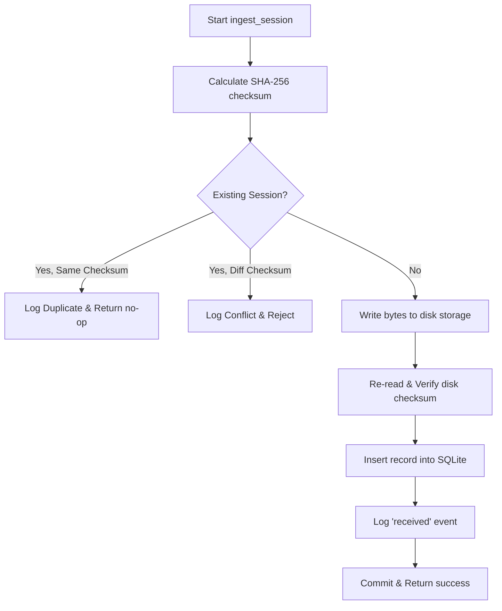
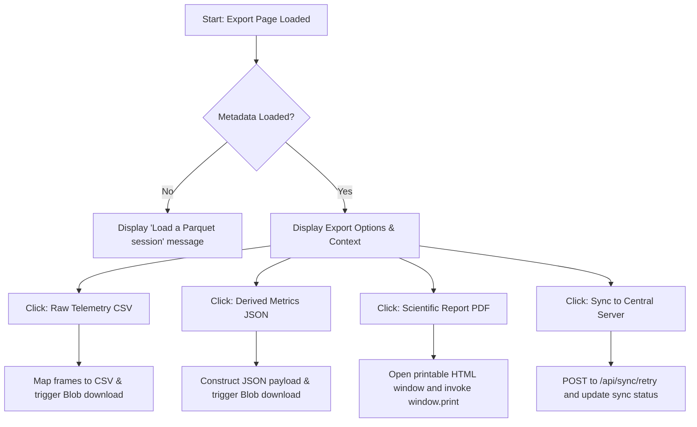
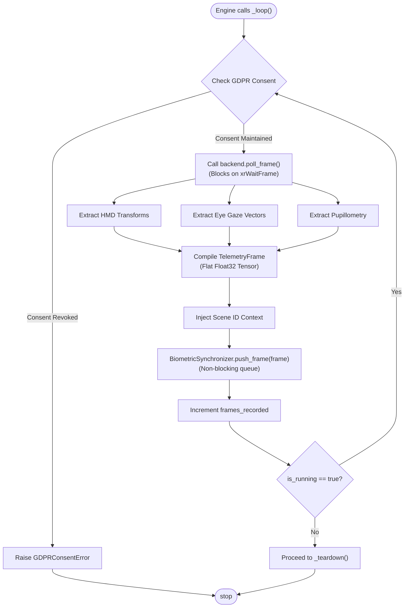

# Auto Installer Activity Central Data Manager Ingest Flow Export Actions Activity Main Hardware Pacing Loop

# Auto Installer Activity

```mermaid
activityDiagram
    start
    :verify_and_install_dependencies;
    :Locate requirements.txt;
    if (File exists?) then (yes)
        :Run pip install via subprocess;
        if (Installation success?) then (yes)
            :Log success;
            stop
        else (no)
            :Log critical error and exit;
            stop
        endif
    else (no)
        :Log error and return;
        stop
    endif
```

---

# Central Data Manager Ingest Flow



---

# Export Actions Activity



---

# Main Hardware Pacing Loop



---

---

## Folder & File Structure

Here is the layout of files and subfolders contained within this path:

```text
activity/
├── README.md
└── main_hardware_pacing_loop.svg
```