# Backend Ocolus Api Backend Steamvr Api Central Server Api Cli Argument Flow Ext Eye Gaze Architecture Eye Tracking Factory Sequence Fb Social Driver Api Htc Tracker Api Main Api Ar Combined

# Backend Ocolus Api

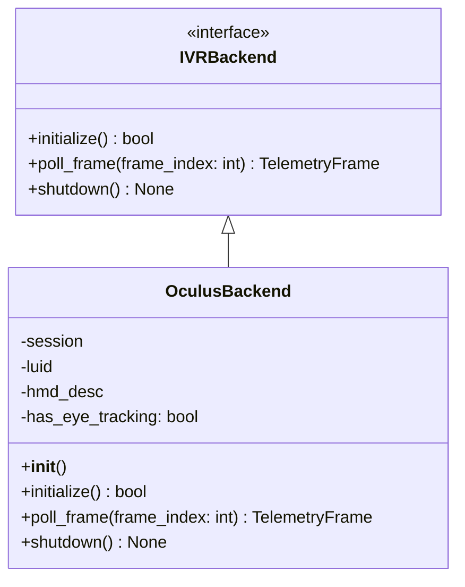

---

# Backend Steamvr Api

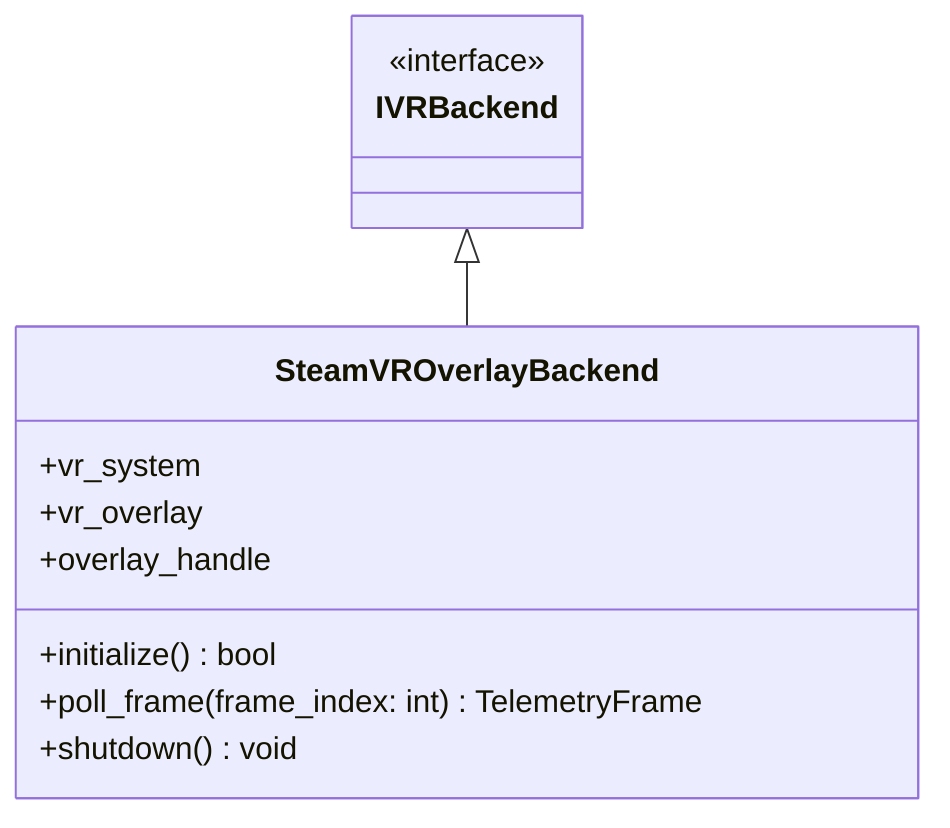

---

# Central Server Api

```mermaid
graph TD;
    Client[Desktop/Client App] -->|/auth/*| AuthMgr[AuthManager]
    Client -->|/license/*| LicenseMgr[LicenseManager]
    Client -->|/data/*| DataMgr[CentralDataManager]
    Admin[Admin Dashboard] -->|/admin/* (require_admin)| Server[FastAPI Server]
    Server --> AuthMgr
    Server --> LicenseMgr
    Server --> DataMgr
```

---

# Cli Argument Flow

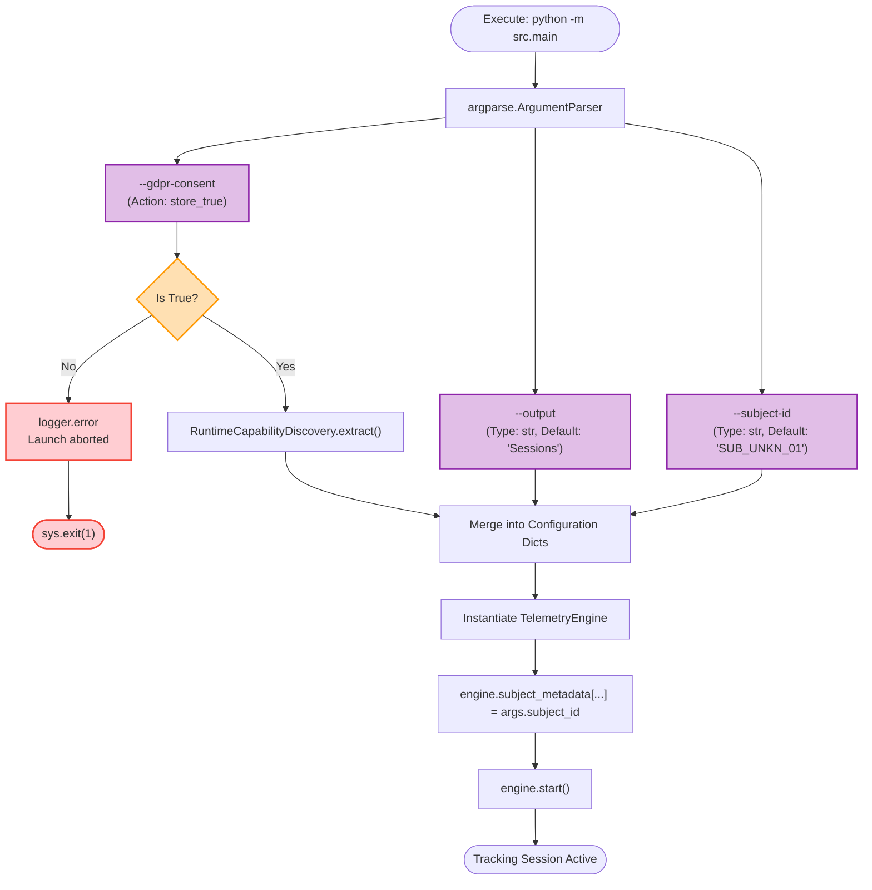

---

# Ext Eye Gaze Architecture

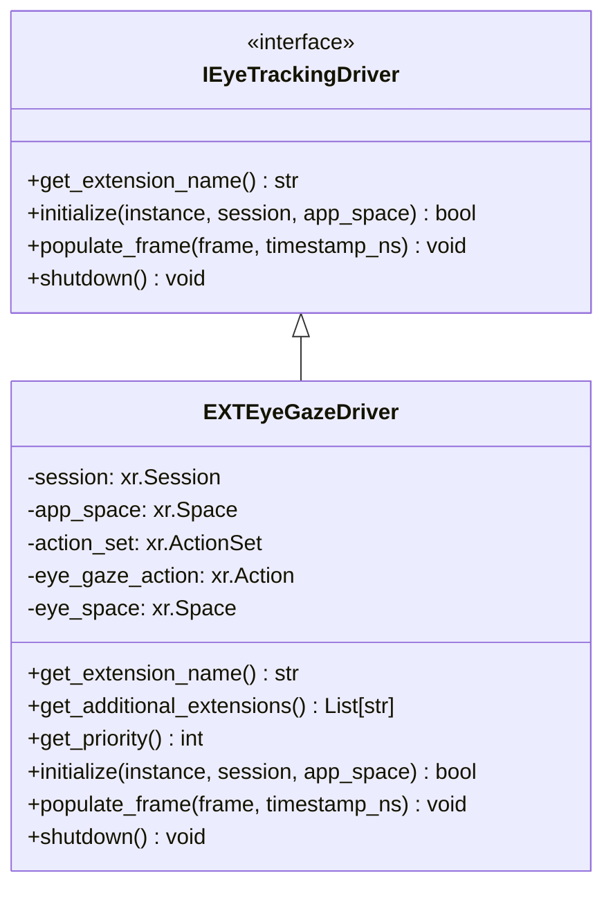

---

# Eye Tracking Factory Sequence

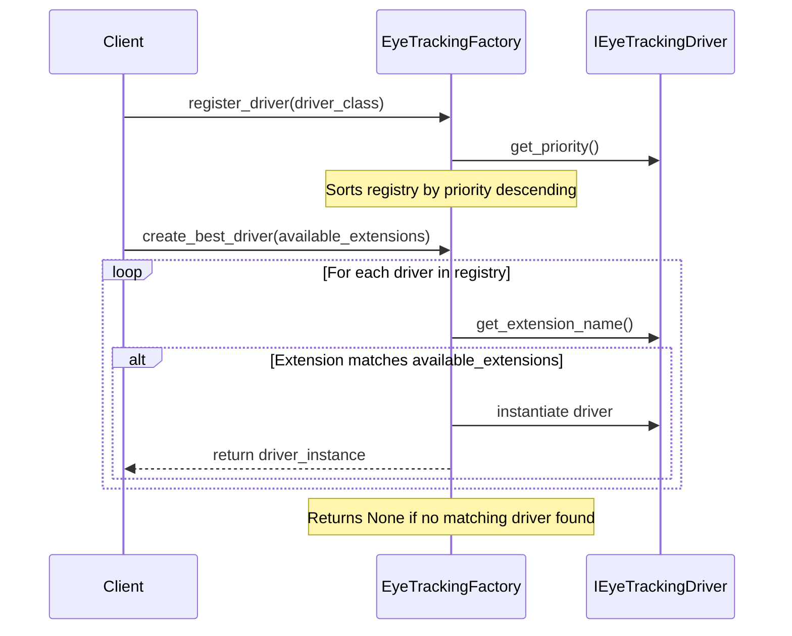

---

# Fb Social Driver Api

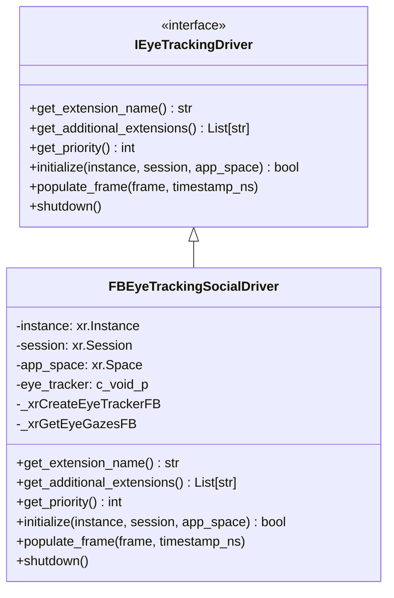

---

# Htc Tracker Api

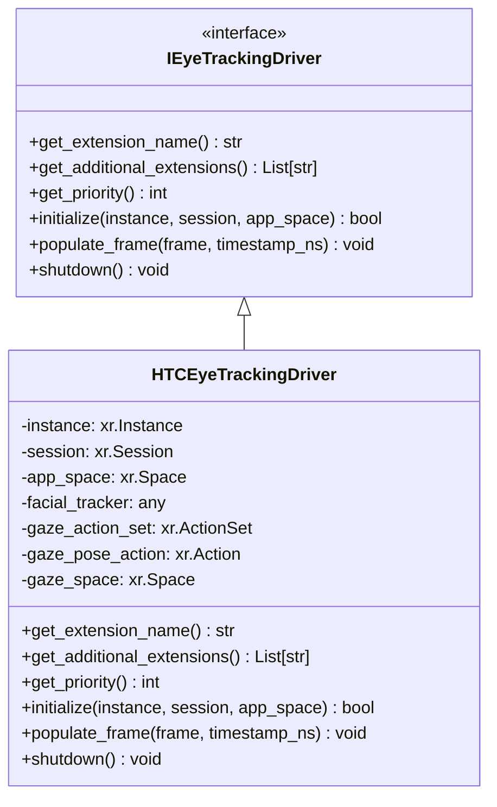

---

# Main Api Architecture

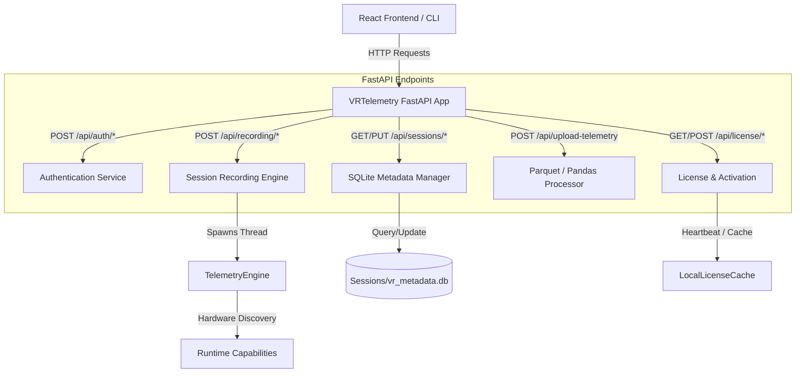

---

# Main Api Workflow

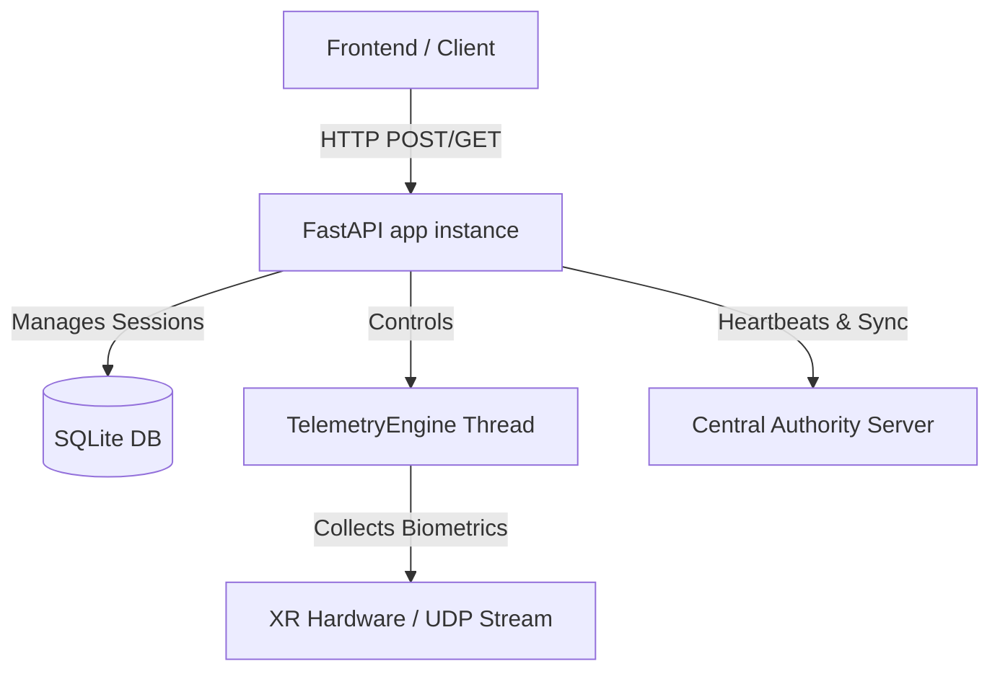

---

# Oculus Backend Api

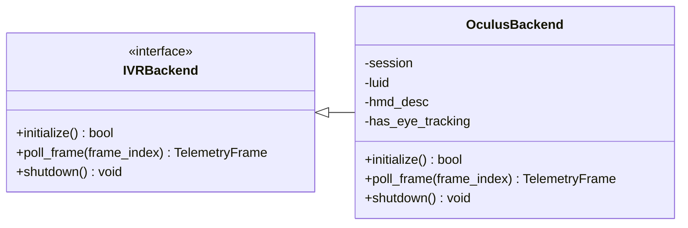

---

# Runtime Capability Discovery

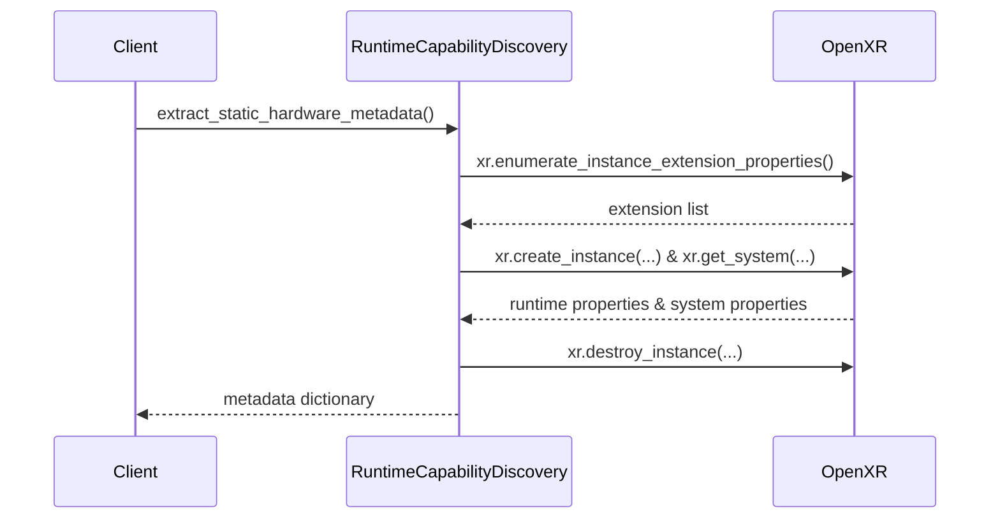

---

# Runtime Capability Discovery Api

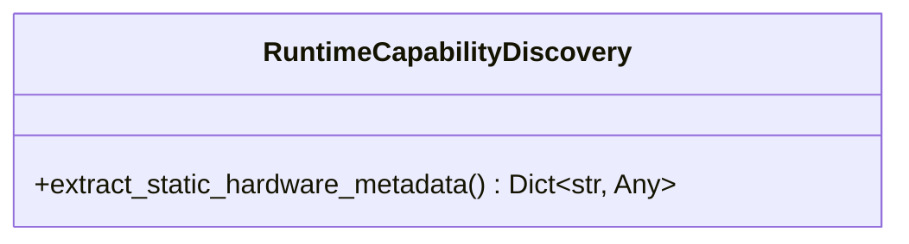

---

# Server Api

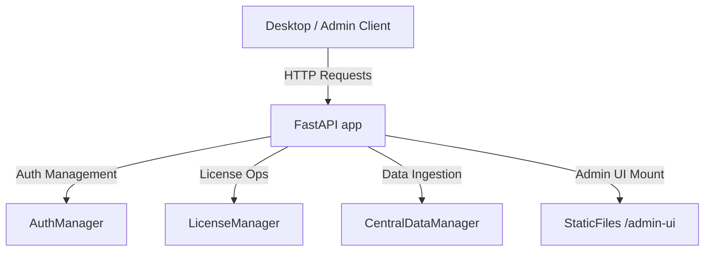

---

# Session Explorer Api Flow

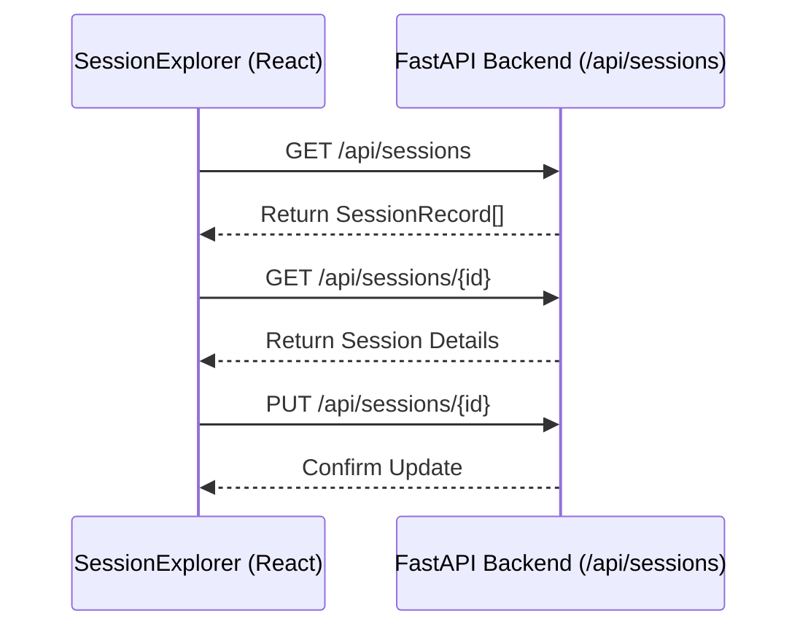

---

# Vr Telemetry Api

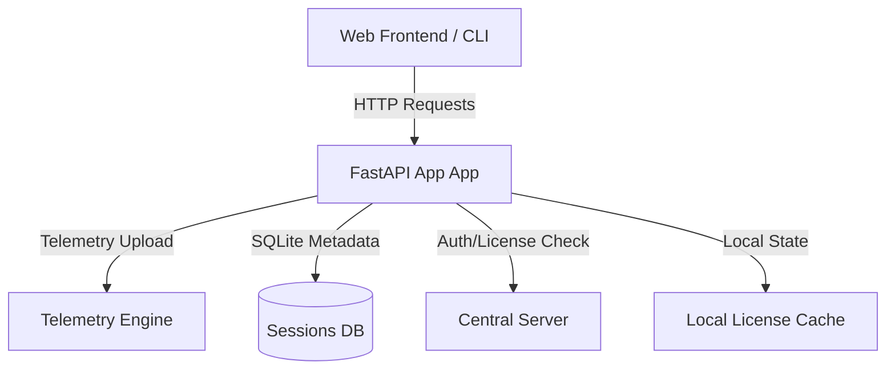

---

# Vrtelemetry Api Architecture

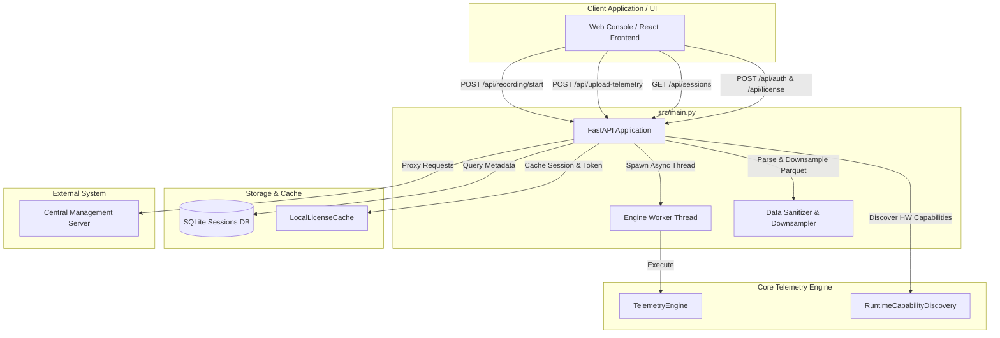

---

---
