# Backends Architecture

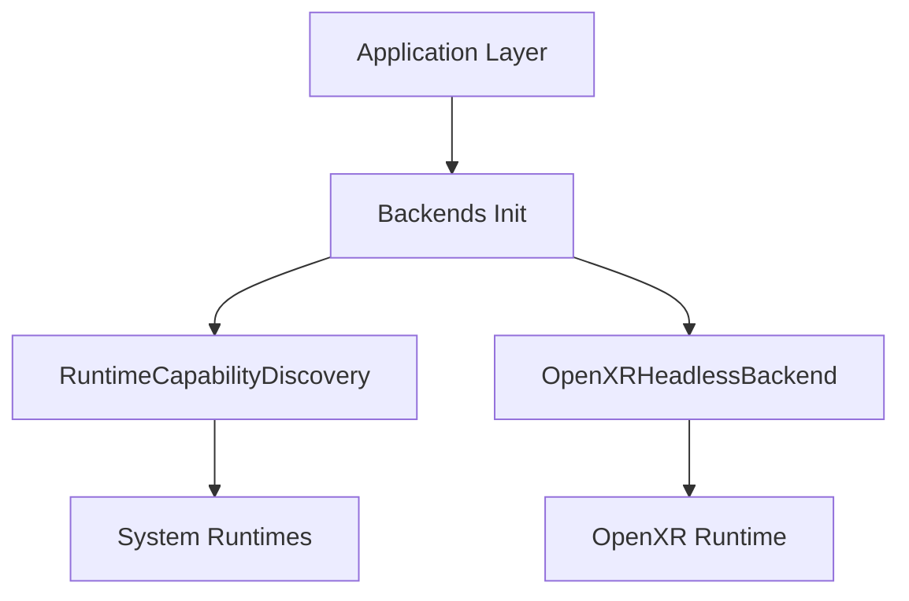

---

# Backends Hal Architecture

```mermaid
graph TD
    subgraph HAL ["Hardware Abstraction Layer (src.backends)"]
        RCD["RuntimeCapabilityDiscovery"]
        OHB["OpenXRHeadlessBackend"]
    end

    App ["Spatial Engine / Client"] -->|"Discovers Capabilities"| RCD
    App -->|"Initializes Context"| OHB
```

---

# Call Graph Bootstrapper

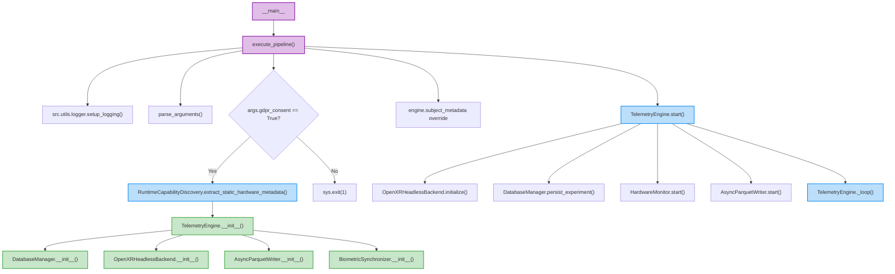

---

# Component Architecture

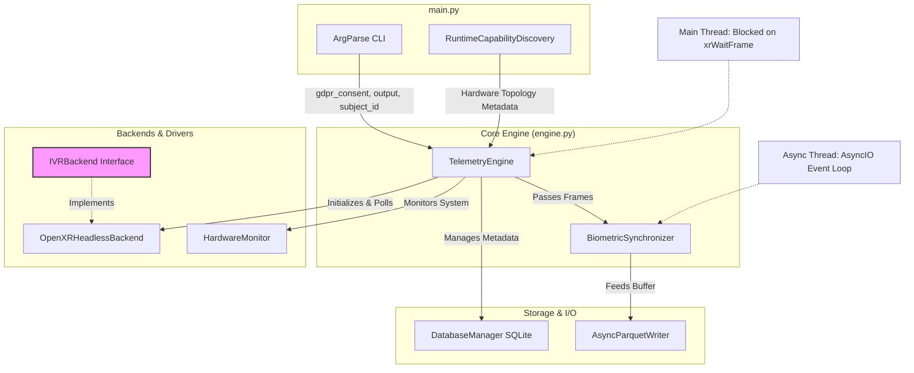

---

# Core Module Architecture

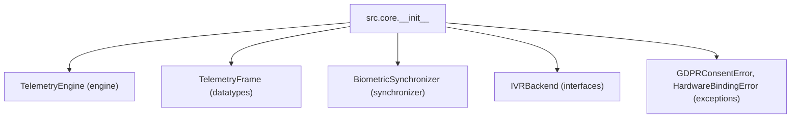

---

# Error Handling Flow

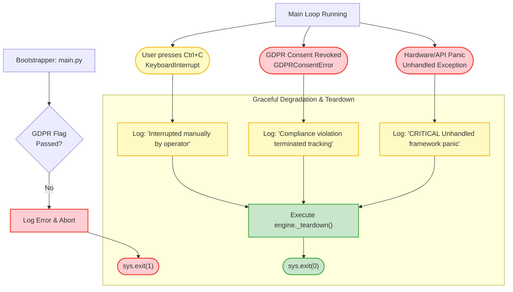

---

# Eye Tracking Architecture

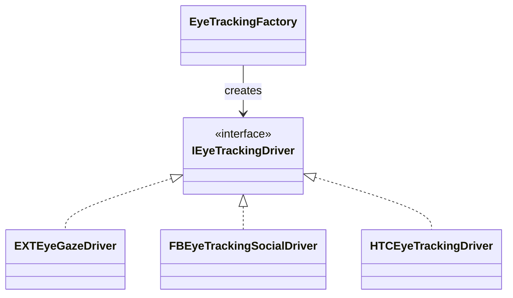

---

# Hardware Monitor Subsystem

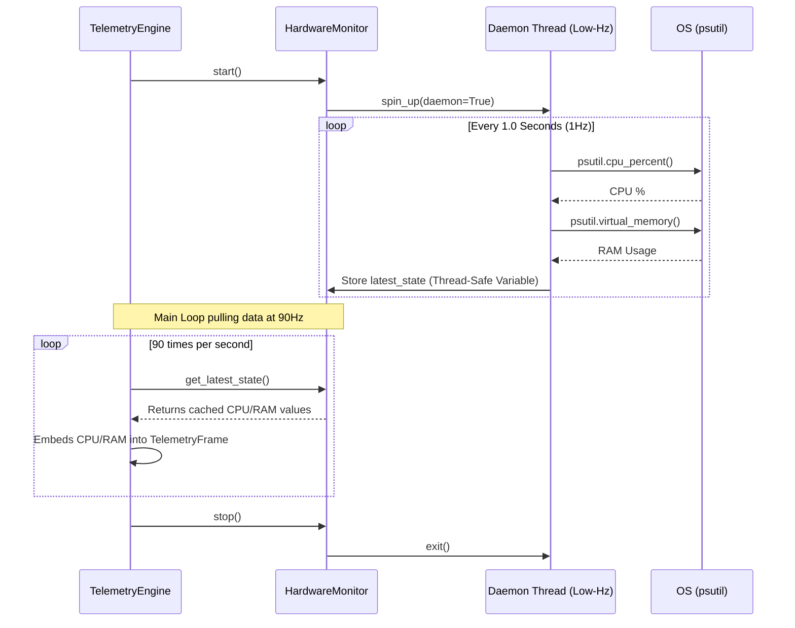

---

# Logger Architecture

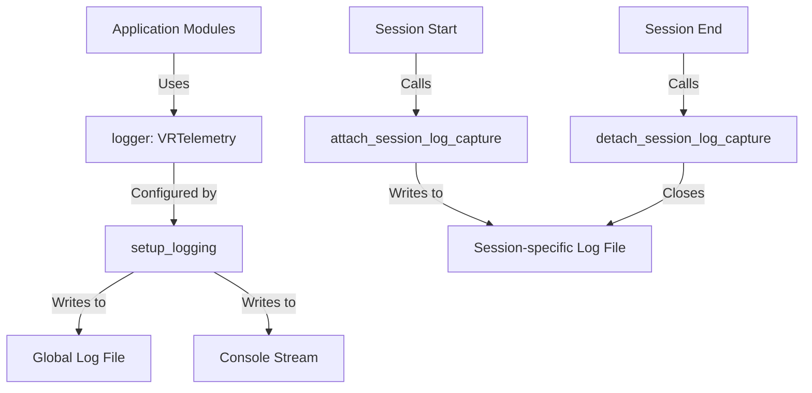

---

# Logging Architecture

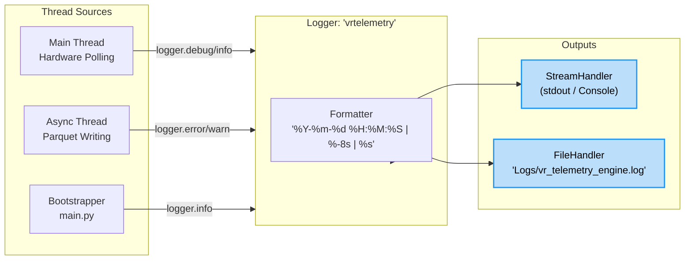

---

# Main Architecture

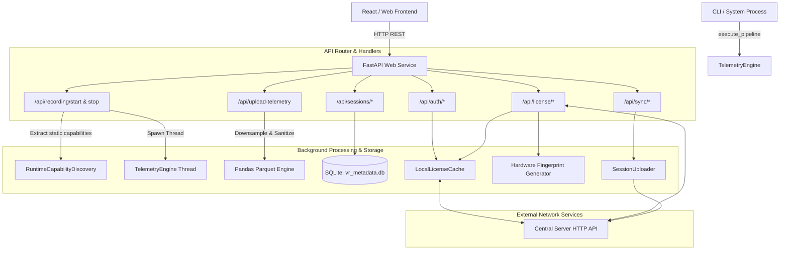

---

# Main Bootstrap Architecture

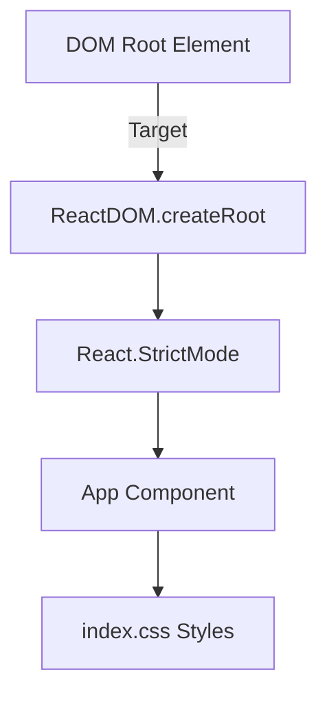

---

# Main Tsx Architecture

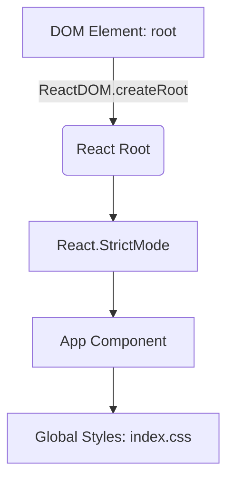

---

# Module Dependencies

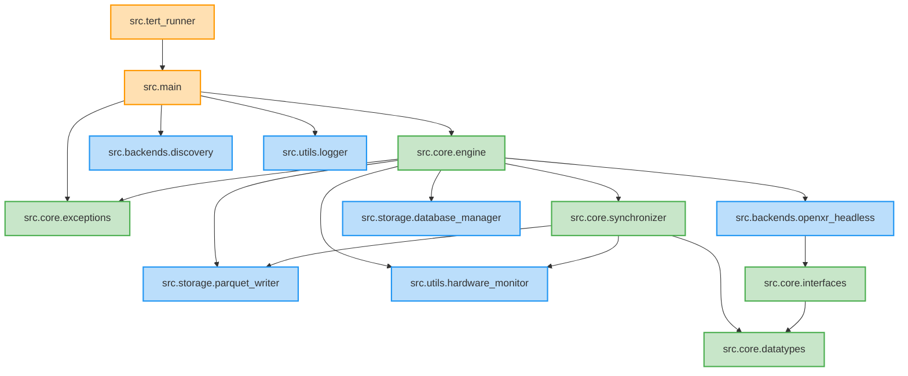

---

# Openxr Backend Architecture

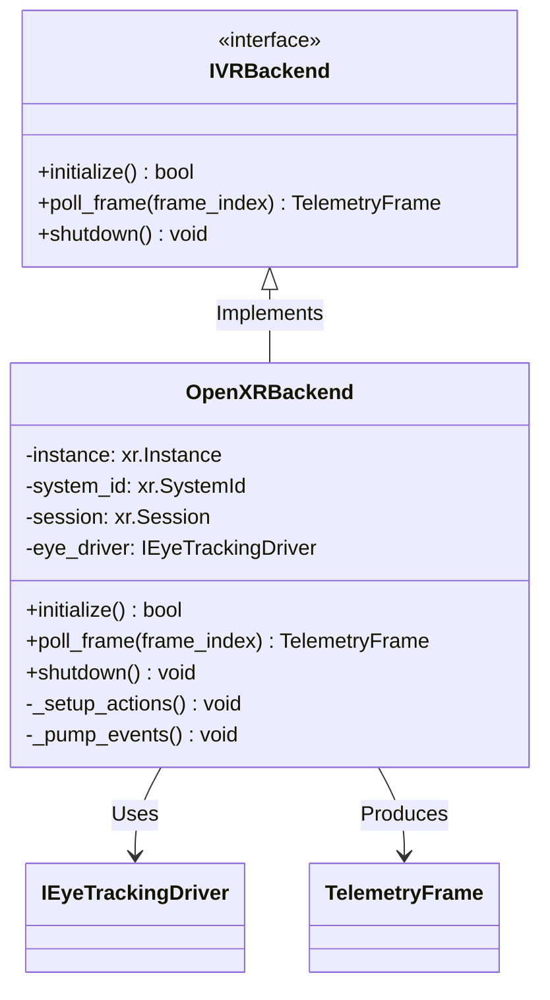

---

# Openxr Headless Architecture

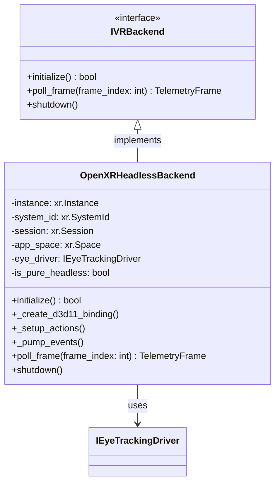

---

# Server Entrypoint Architecture

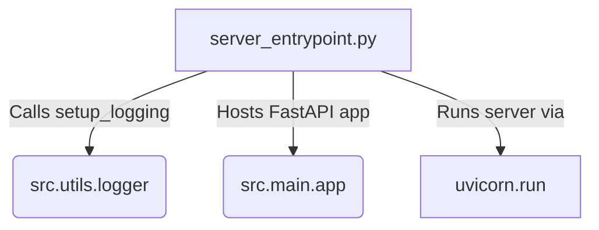

---

# Spatial Viewer Architecture

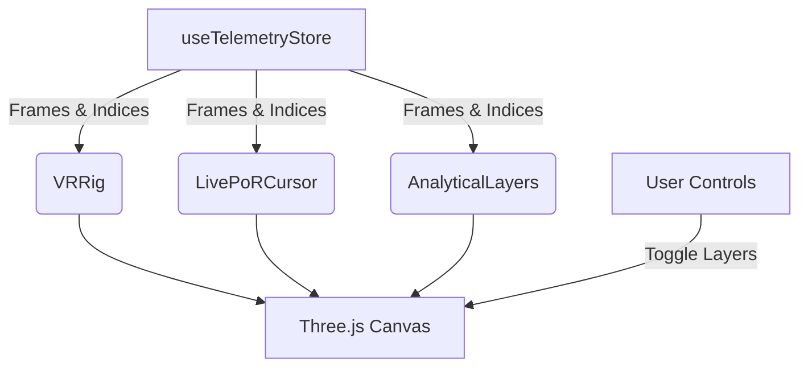

---

# Storage Architecture

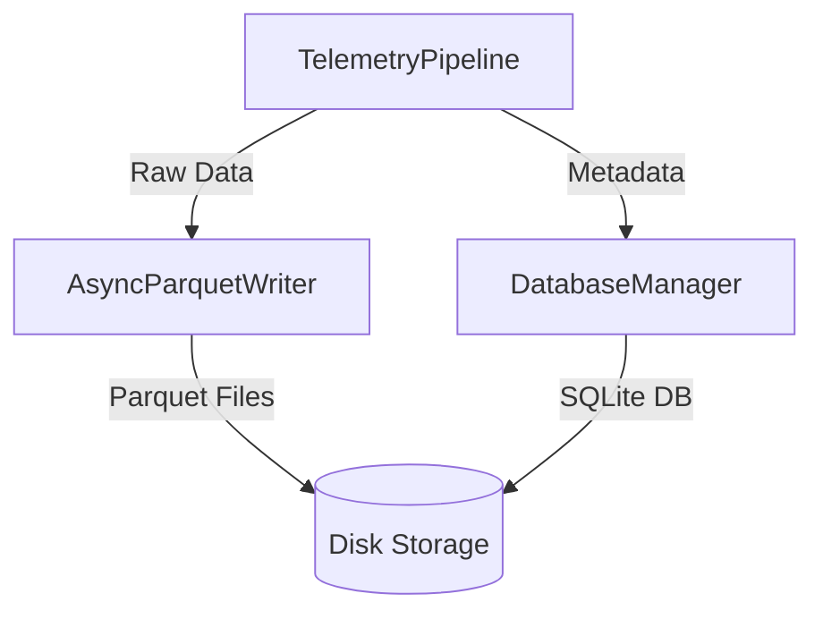

---

# Telemetry Core Architecture

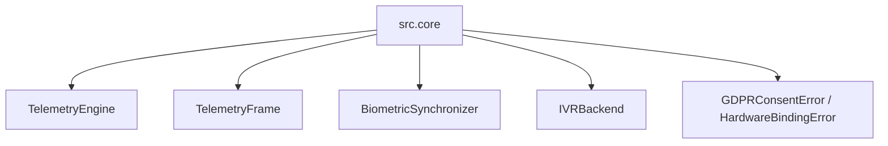

---

# Thread Synchronization

```mermaid
flowchart TD
    subgraph Main_Thread ["Main Thread (Hardware Locked)"]
        direction TB
        xrWait[OpenXR xrWaitFrame<br/>Blocks strictly to hardware vsync]
        Poll[poll_frame<br/>Captures TelemetryFrame]
        Push[BiometricSynchronizer.push_frame]
        xrWait --> Poll --> Push
    end

    subgraph Memory_Bridge ["Memory / Sync Layer"]
        RingBuffer[(Thread-Safe Queue / Ring Buffer)]
    end

    subgraph Async_Thread ["Async Event Loop Thread"]
        direction TB
        Pop[Pop Frame from Buffer]
        Batch[Batch Frames in Memory]
        WriteIO[AsyncParquetWriter.write_batch<br/>Awaited Disk I/O]
        Pop --> Batch --> WriteIO
    end

    Push == "Non-blocking Push" ==> RingBuffer
    RingBuffer == "Async Pull" ==> Pop

    classDef hardware fill:#ffe0b2,stroke:#ff9800,stroke-width:2px,color:#000;
    classDef memory fill:#c8e6c9,stroke:#4caf50,stroke-width:2px,color:#000;
    classDef io fill:#bbdefb,stroke:#2196f3,stroke-width:2px,color:#000;
    
    class Main_Thread hardware;
    class Memory_Bridge memory;
    class Async_Thread io;
```

---

# Utils Layer Architecture

```mermaid
graph TD
    A[Application Core] --> B[utils.__init__]
    B --> C[logger]
    B --> D[HardwareMonitor]
```

---
