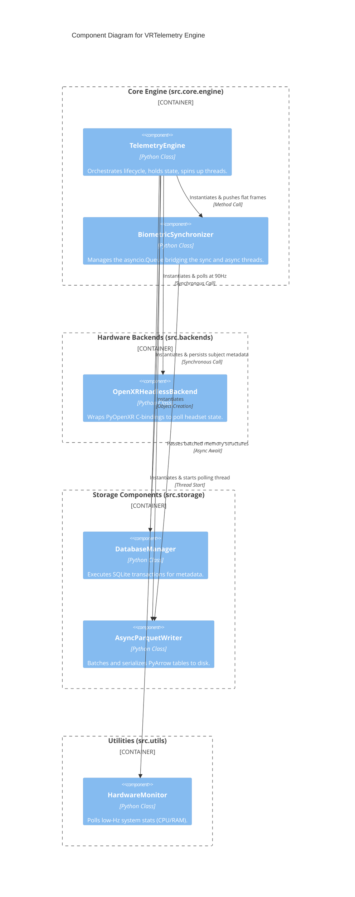
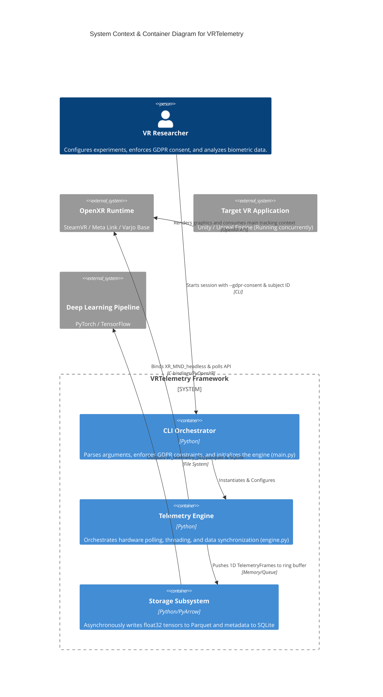

# C4 Component Engine C4 Context Container

# C4 Component Engine



---

# C4 Context Container



---

---

## Folder & File Structure

Here is the layout of files and subfolders contained within this path:

```text
c4/
├── README.md
├── c4_component_engine.svg
└── c4_context_container.svg
```