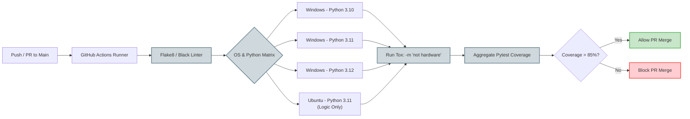
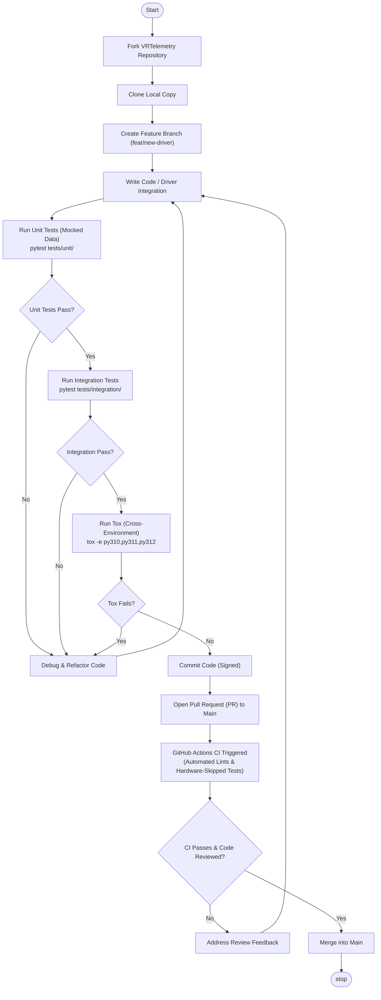
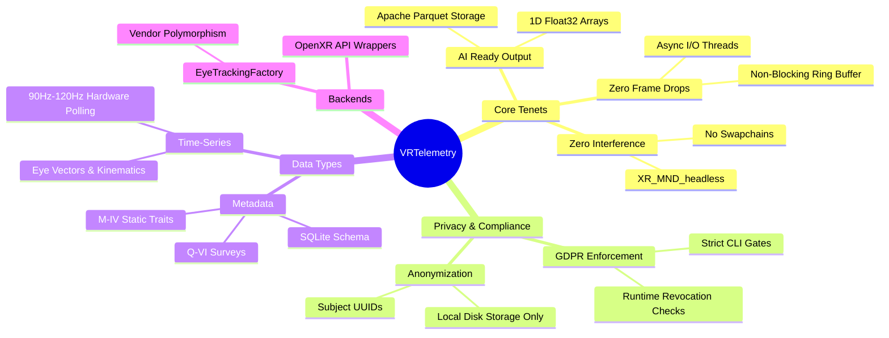

# Ci Cd Execution Matrix Contribution Workflow Quick Reference Mindmap

# Ci Cd Execution Matrix



---

# Contribution Workflow



---

# Quick Reference Mindmap



---

---

## Folder & File Structure

Here is the layout of files and subfolders contained within this path:

```text
developer/
├── README.md
├── ci_cd_execution_matrix.svg
├── contribution_workflow.svg
└── quick_reference_mindmap.svg
```