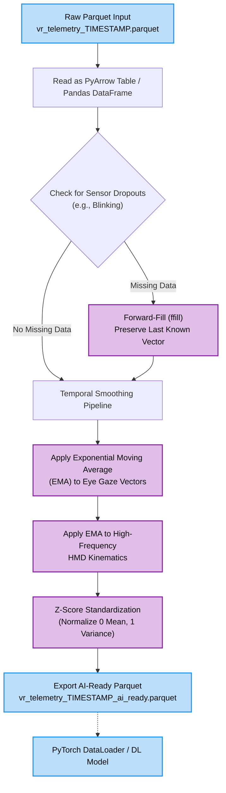
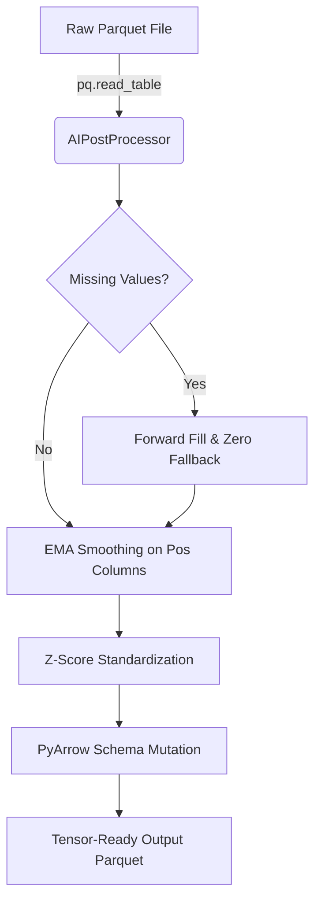
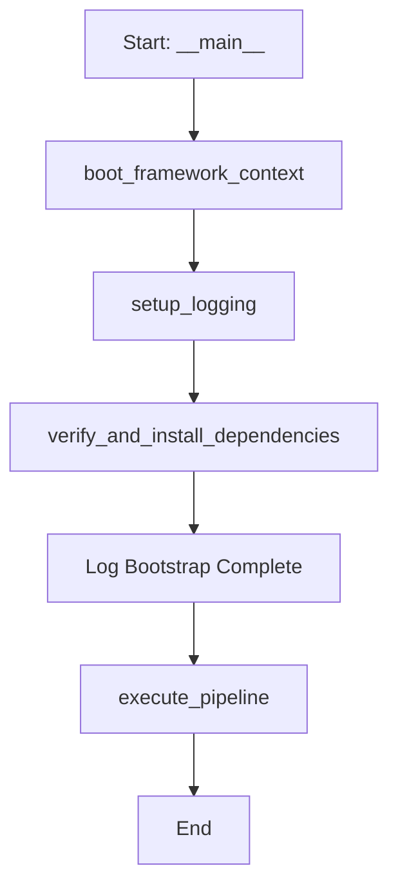

# Ai Post Processor Flow Ai Preprocessor Pipeline Tert Runner Pipeline Udp Receiver Pipeline

# Ai Post Processor Flow



---

# Ai Preprocessor Pipeline



---

# Tert Runner Pipeline



---

# Udp Receiver Pipeline

```mermaid
pipeline
    title UDP Ingestion Pipeline
    subgraph Source
        A[Quest Pro Overlay] -->|Raw UDP Datagrams| B(NativeQuestHarvesterProtocol)
    end
    subgraph Ingestion Service
        B --> C{Packet Size Valid?}
        C -->|No| D[Discard Packet]
        C -->|Yes| E[Unpack 64-byte Binary Struct]
        E --> F[Map to TelemetryFrame]
        F --> G[Normalize Confidences]
        G --> H[Push to BiometricSynchronizer]
    end
```

---

---
