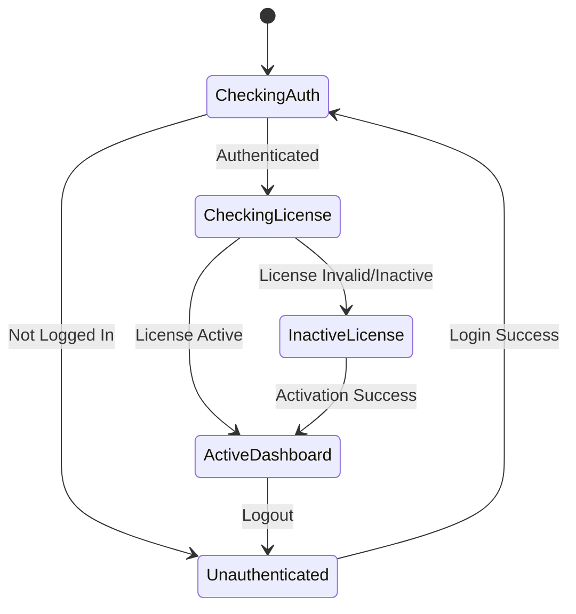
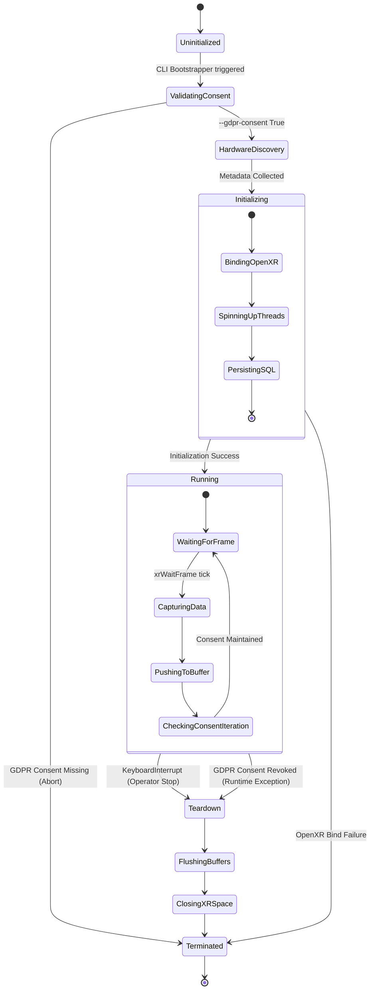
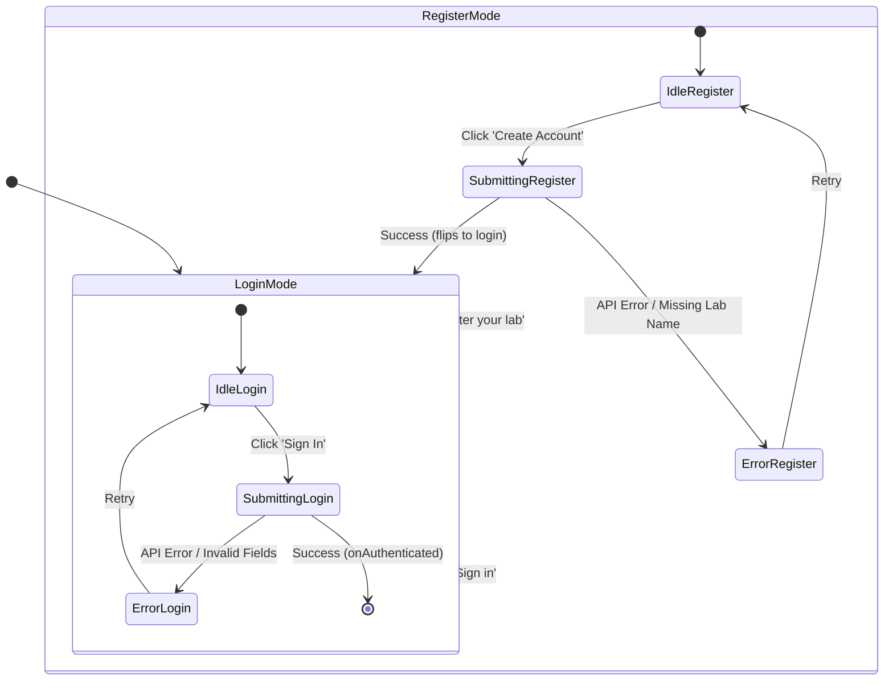
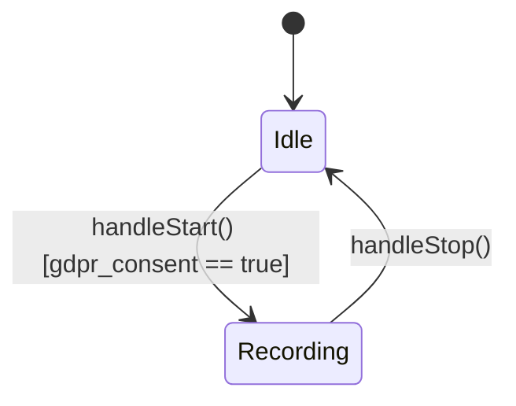
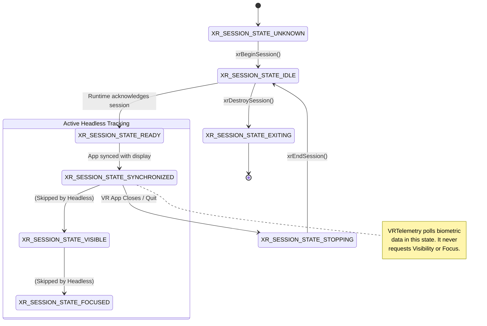
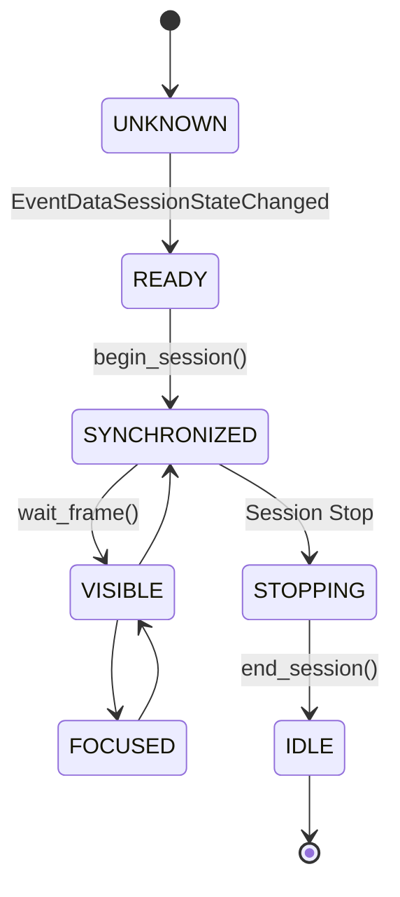
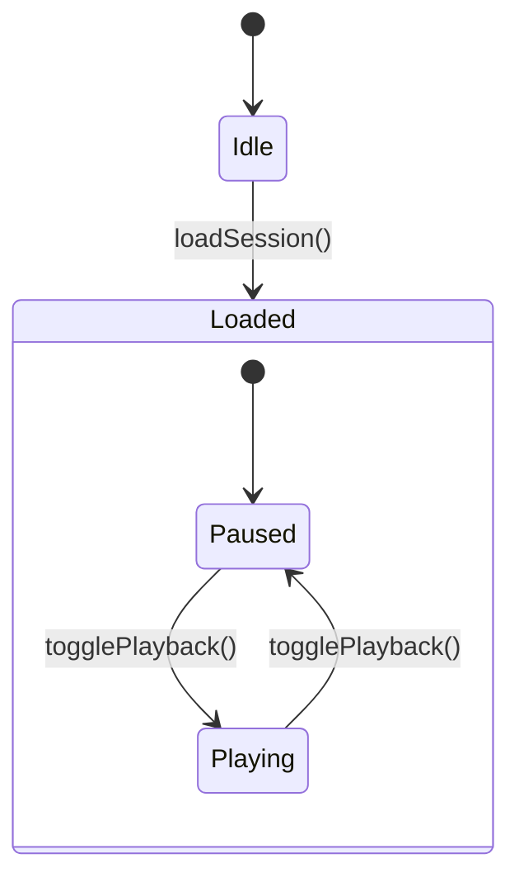

# App Lifecycle State

---

# Engine Lifecycle

---

# Login Component States

---

# New Session State Machine

---

# Openxr Session Lifecycle

---

# Openxr Session States

---

# Telemetry Store State

---
