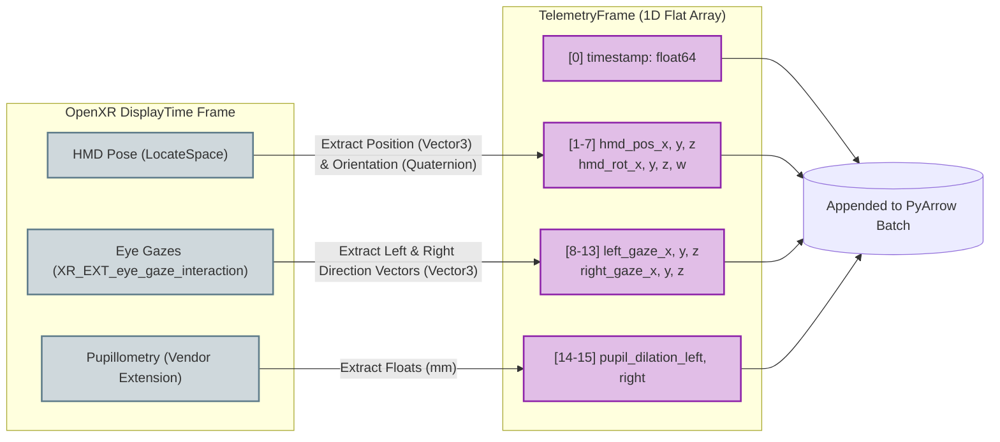
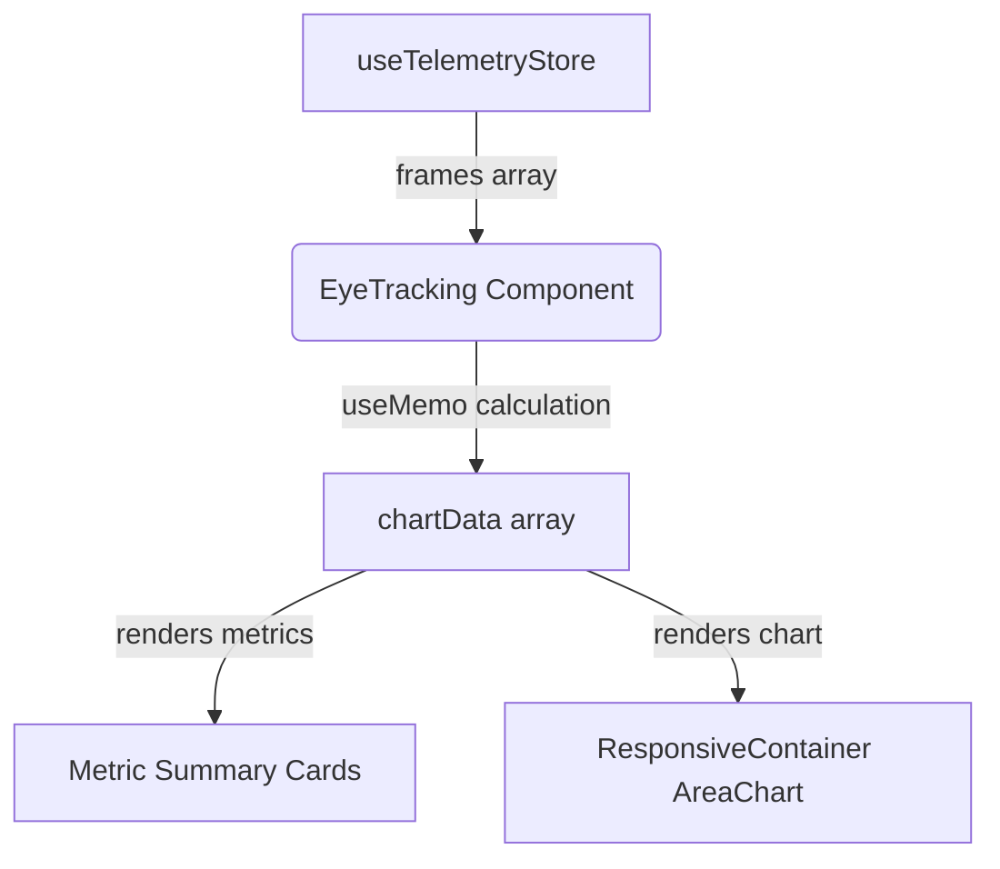
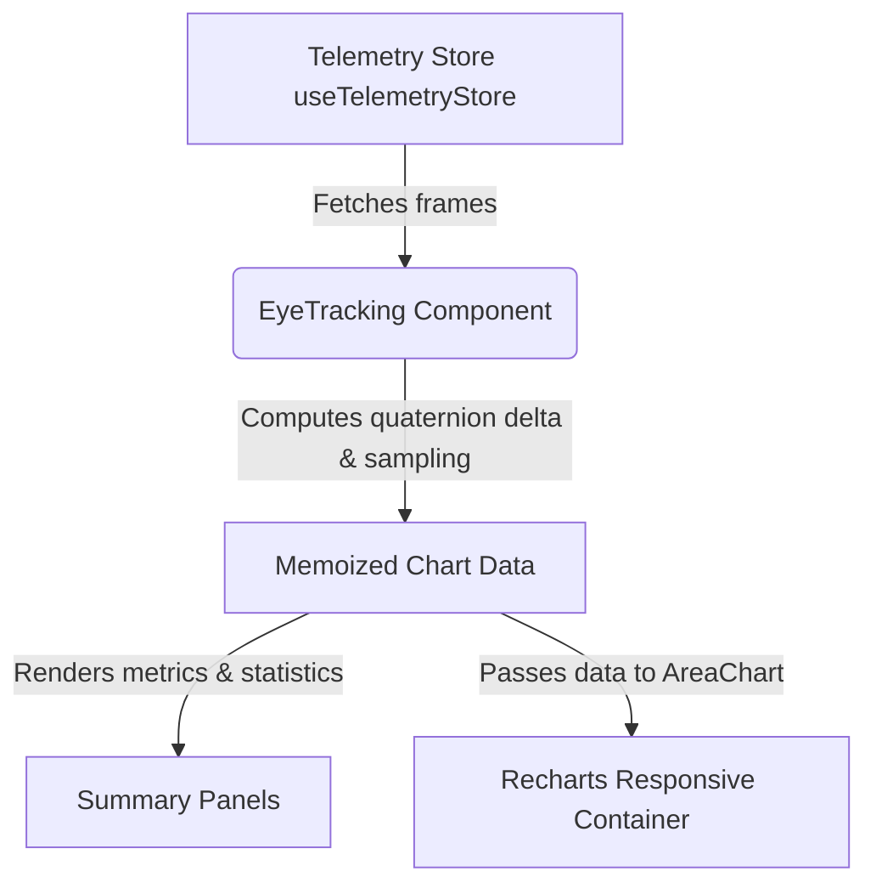
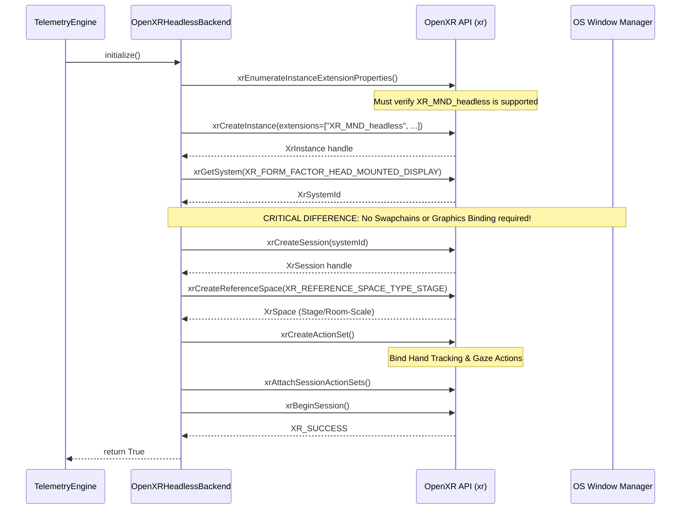
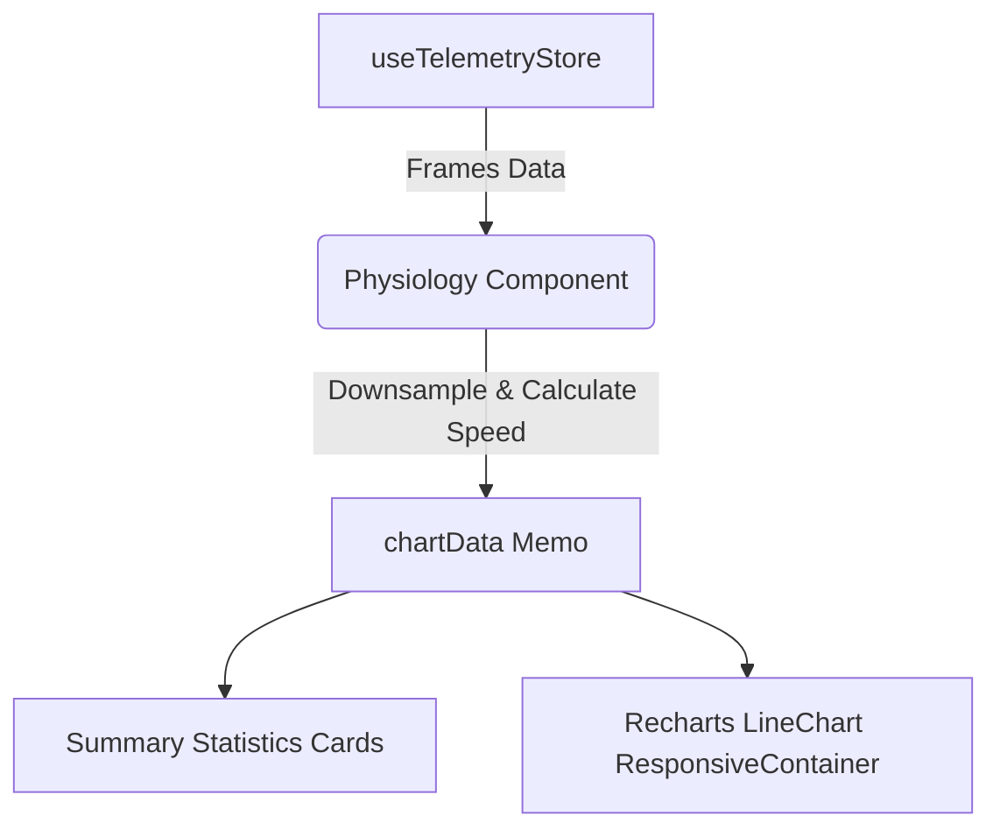
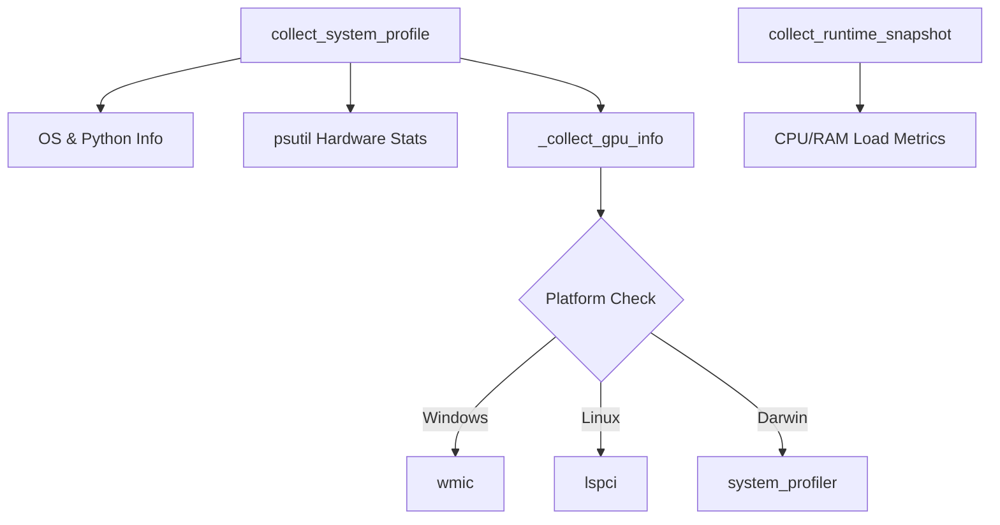
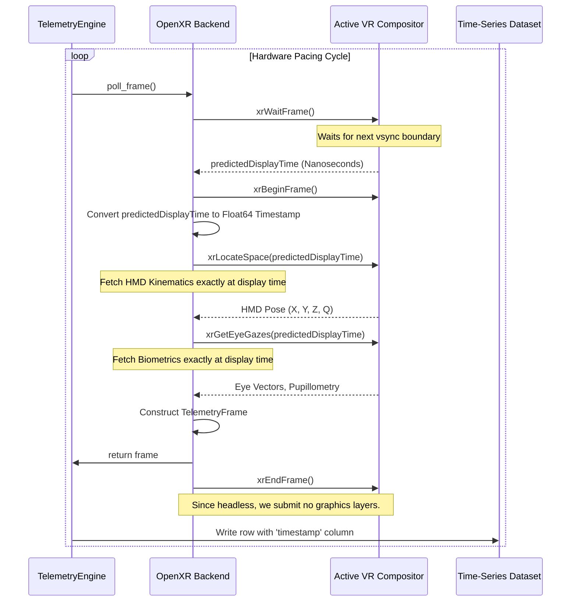

# Biometric Vector Assembly Eye Tracking Dataflow Eye Tracking Telemetry Flow Openxr Headless Initialization Physiology Dataflow Physiology Telemetry Flow System Profiler Telemetry T Combined

# Biometric Vector Assembly



---

# Eye Tracking Dataflow



---

# Eye Tracking Telemetry Flow



---

# Openxr Headless Initialization



---

# Physiology Dataflow

```mermaid
graph TD
    A[useTelemetryStore] -->|Retrieves raw frames| B(Physiology Component)
    B -->|Downsamples & calculates speed| C[chartData Memo]
    C -->|Renders statistics| D[Summary Cards]
    C -->|Feeds dual-axis data| E[Recharts LineChart]
    E -->|Left Y-Axis| F[Heart Rate (BPM)]
    E -->|Right Y-Axis| G[Head Speed (m/s)]
```

---

# Physiology Telemetry Flow



---

# System Profiler Telemetry



---

# Time Synchronization Pipeline



---

---
