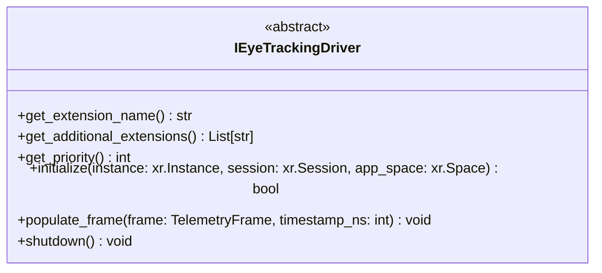
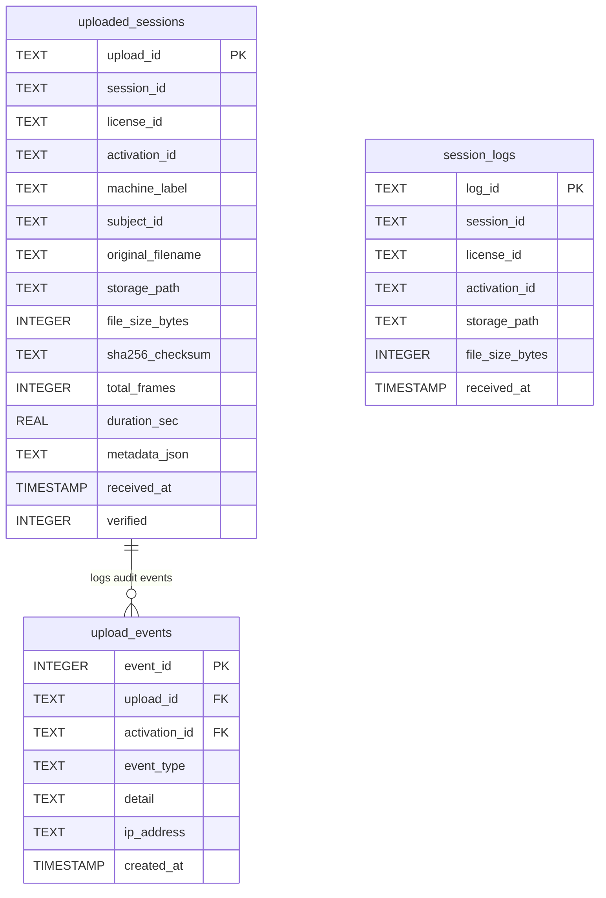
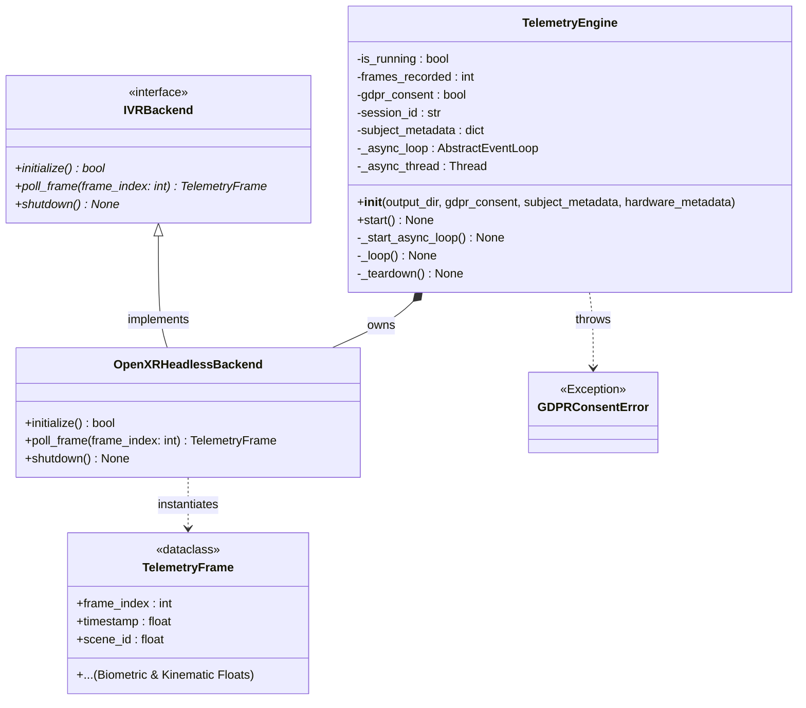
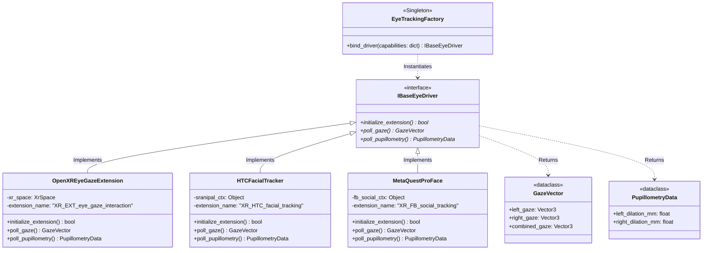
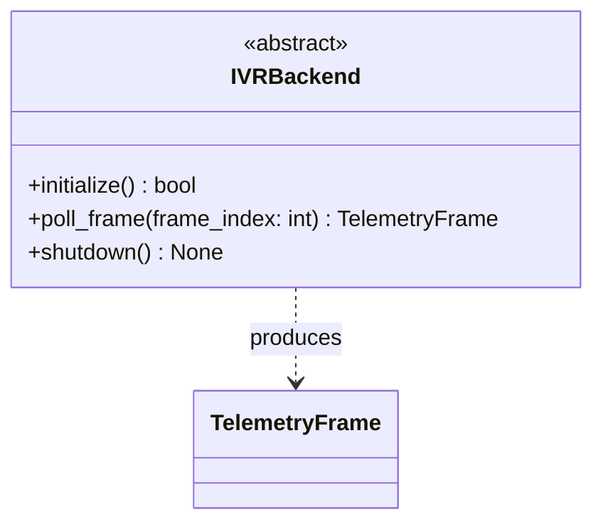
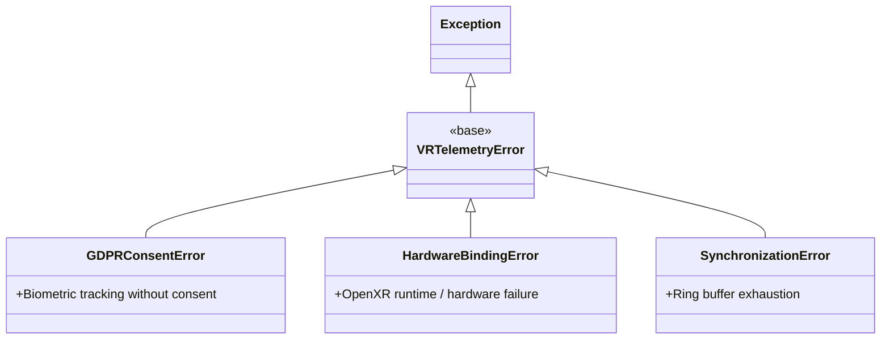

# Base Driver Uml Central Data Schema Er Core Class Diagram Eye Tracking Driver Hierarchy Eye Tracking Driver Uml Ivr Backend Interface Vr Telemetry Exceptions

# Base Driver Uml



---

# Central Data Schema Er



---

# Core Class Diagram



---

# Eye Tracking Driver Hierarchy



---

# Eye Tracking Driver Uml


---

# Ivr Backend Interface



---

# Vr Telemetry Exceptions



---

---

## Folder & File Structure

Here is the layout of files and subfolders contained within this path:

```text
uml/
├── README.md
├── core_class_diagram-1.svg
├── core_class_diagram.svg
└── eye_tracking_driver_hierarchy.svg
```